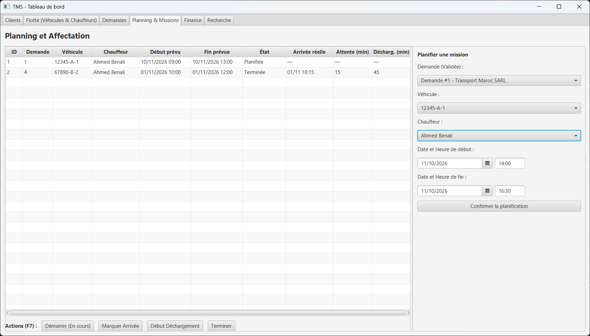
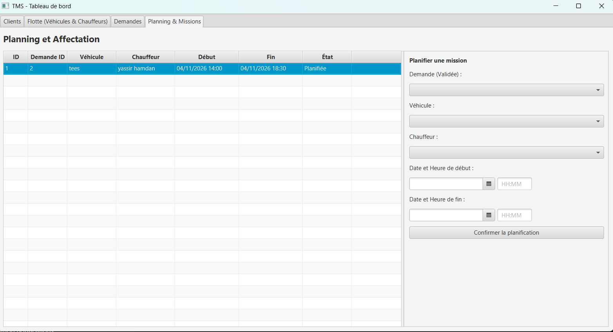
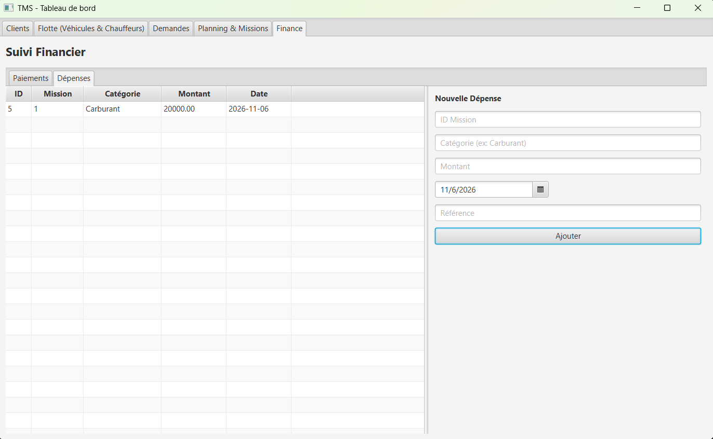
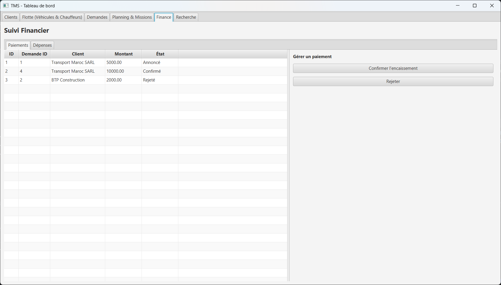
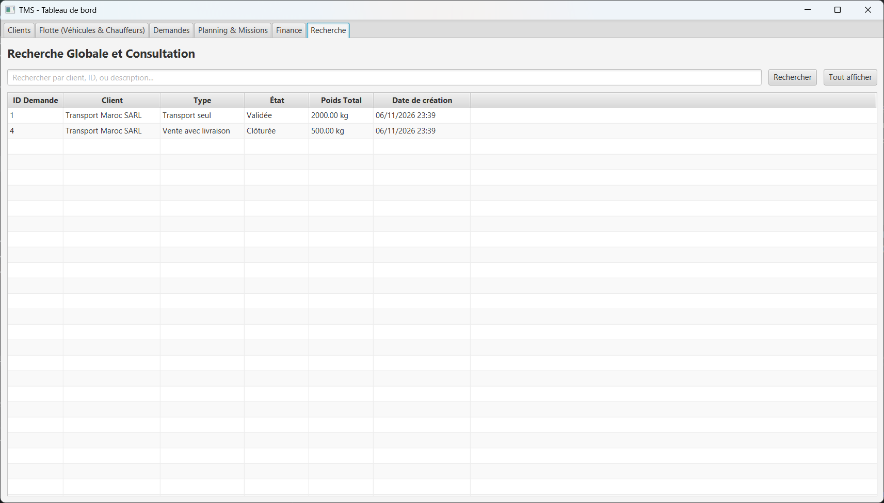
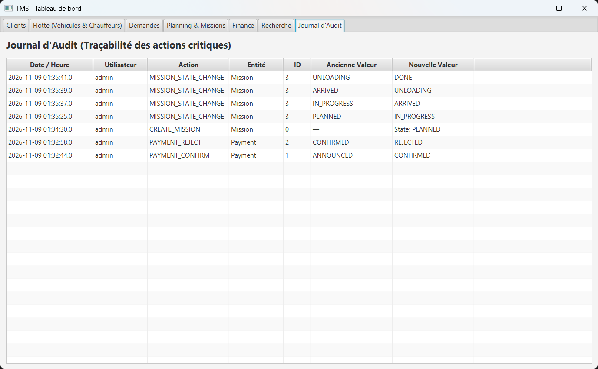

# TMS - Transport Management System

Une application desktop JavaFX de gestion du transport : clients, chauffeurs, véhicules, planification et suivi financier.

## Fonctionnalités
- **Authentification** : Connexion sécurisée avec gestion des rôles (Admin, Coordinateur, Financier).
- **Données de référence** : Gestion des clients, chauffeurs et véhicules.
- **Demandes** : Cycle de vie complet (Brouillon → Validée → Clôturée).
- **Planning & Missions** : Affectation des ressources avec détection des conflits de dates.
- **Suivi des missions** : Gestion des états (En cours, Arrivée, Déchargement, Terminée) et calcul des temps.
- **Finance** : Suivi des paiements (annonce, confirmation) et des dépenses.
- **Recherche** : Filtre global des demandes.
- **Audit** : Journal des actions critiques (traçabilité).

## Démonstration

### Connexion

### Clients

### Chauffeurs

### Véhicules

### Demandes

### Affectation

### Planning

### Dépenses

### Paiements

### Recherche

### Audit

## Installation et lancement

1. **Prérequis** : Java 17, Maven, MySQL.
2. **Base de données** :
    - Créez une base de données `tms` dans MySQL.
    - Exécutez le script `src/main/resources/db/schema.sql`.
3. **Compte par défaut** :
    - Lancez `SeedAdmin.java` pour créer le compte administrateur.
    - Identifiants : `admin` / `admin123`.
4. **Lancement** :
    - Ouvrez le projet dans IntelliJ IDEA.
    - Lancez la classe `MainApp.java` ou utilisez la commande `mvn javafx:run`.