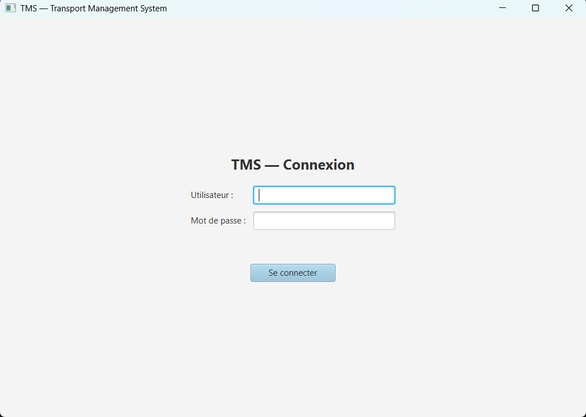
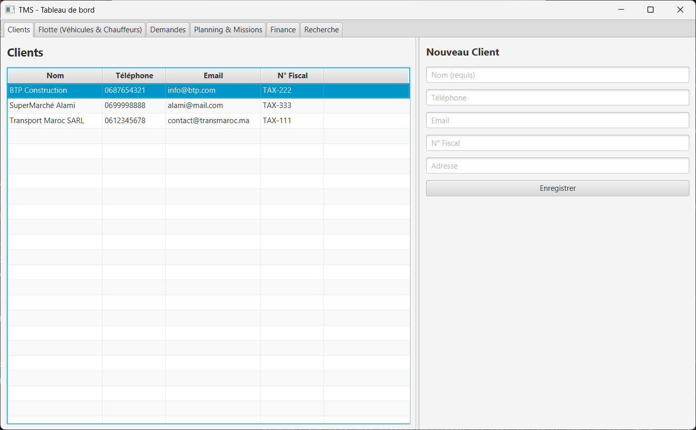
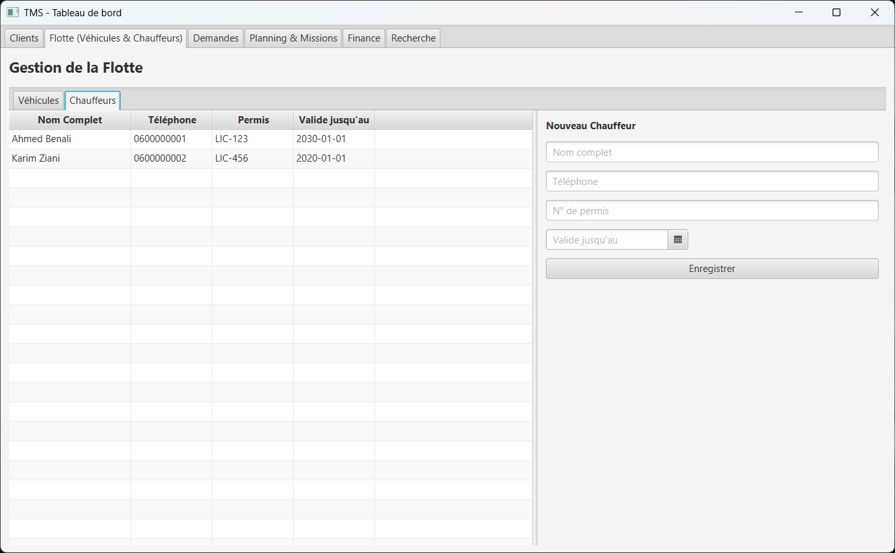
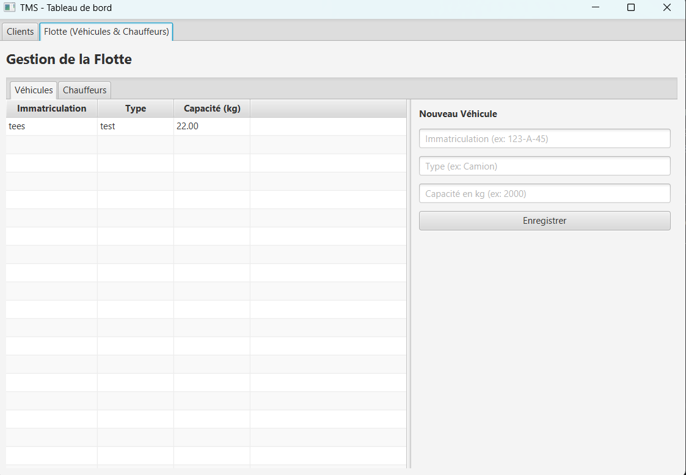
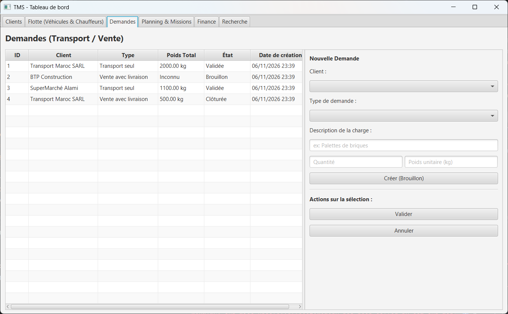

# TMS - Transport Management System

Une application simple de gestion du transport : clients, chauffeurs et véhicules.

## Démonstration

### Connexion

### Clients

### Chauffeurs

### Véhicules

### Demandes

---

**Pas encore terminé.**